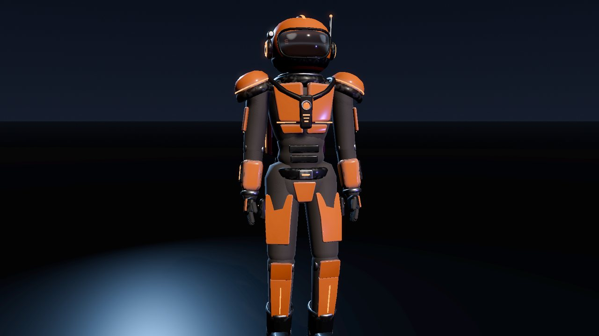
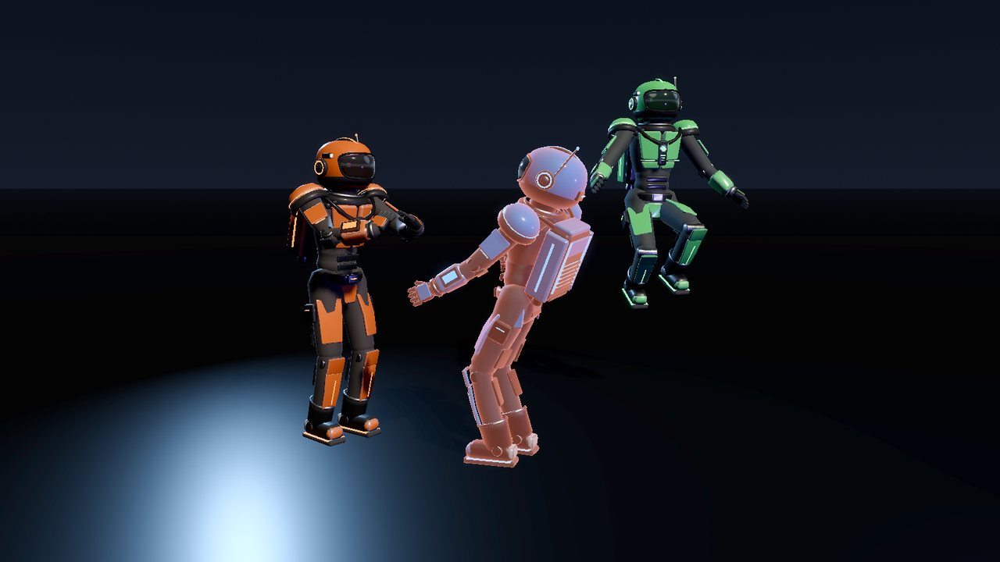

# Looks log

How Drift Station looks over time, newest first. Recorded with `python tools/record_looks.py --label <slug> --note "..."`, which plays real bot rounds on a rendered client. Cloud captures use the GL Compatibility renderer; phones use the Mobile renderer, so lighting differs slightly.

## 2026-11-15 · character-v1 (owner approved)

Procedural crew suit, first iteration from the character pass: studio renders, not gameplay. Owner: "this is actually really nice." Kept as the baseline the next character pass must beat. [folder](2026-11-15-character-v1/)

| | |
| --- | --- |
|  run strip |  turntable |
|  front |  action |
|  states |  carry |
|  stunned |  backs lowlight |
|  distance |  helmet |
|  visor |  chest |

